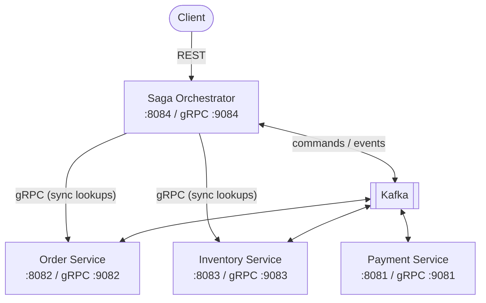
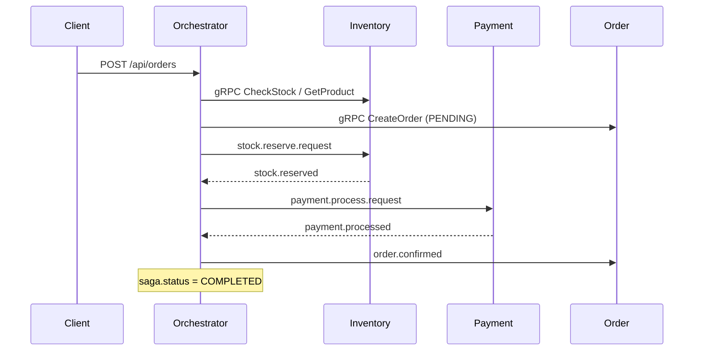
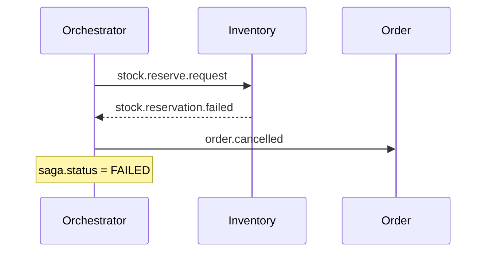
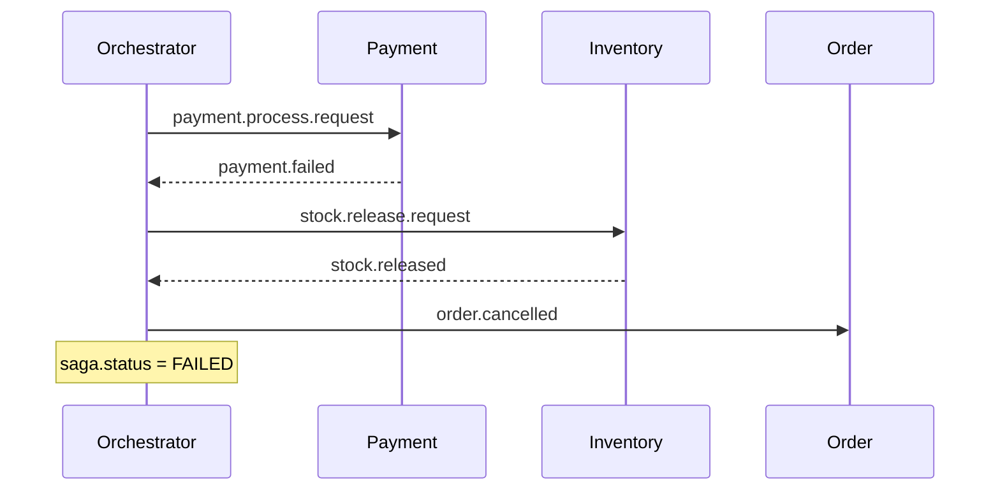

# Saga Pattern Payment System

A hands-on Saga Orchestration Pattern implementation across 4 Spring Boot services (Order, Payment, Inventory, Orchestrator), using Kafka for async choreography and gRPC for sync lookups. Not production-ready — a system-design study project.

---

## The Scenario: "Payment Deducted, But Order Failed"

Across independent services with separate databases, there's no single transaction spanning "charge the customer" and "confirm the order." If the coordinating process crashes mid-flow, money can move while the order never completes.

This project's saga charges payment **last**, after order + stock succeed, so a decline never has to unwind a completed charge. The remaining gap — the orchestrator crashing *between* "payment approved" and "order confirmed" — is closed by:

- **Transactional outbox** — state change + "publish this event" commit in one DB transaction
- **Idempotency keys** — every write path is safe to retry, no double-charge/double-reserve
- **Stuck saga recovery** — a scheduler resends the missing step for sagas stuck mid-flight

See [Reliability Mechanisms](#reliability-mechanisms) for how each one works.

---

## Architecture



---

## Saga Flow

### Happy Path



### Compensation — Stock Reservation Fails



### Compensation — Payment Fails



*(amounts >= 10,000 are auto-declined by the simulated gateway, to trigger this path on demand)*

---

## Reliability Mechanisms

| Mechanism | What it does | Key config |
|---|---|---|
| Transactional outbox | Domain write + outbox row commit in one local transaction; a poller claims rows with `FOR UPDATE SKIP LOCKED` and publishes to Kafka, retrying with backoff | `outbox.poller.fixed-delay-ms=2000`, `batch-size=50` |
| Idempotency keys | Order/payment/stock/saga writes look up by key first, replay on duplicate; orchestrator derives per-step keys (`<sagaId>:PAYMENT_PROCESS`, etc.) | `Idempotency-Key` header on `POST /api/orders` |
| Kafka retry + DLQ | Failed consumer messages retry with backoff, then land on `<topic>.DLT` instead of blocking the consumer group | 3 retries, 500ms initial backoff |
| Stuck saga recovery | Scheduler claims stale `STARTED`/`COMPENSATING` sagas and resends the missing command, escalating to compensation after max attempts | `saga.recovery.stuck-threshold-seconds=120`, `max-attempts=5` |

`payment.cancel.request` / `payment.cancelled` (reversing an already-successful payment) are wired end-to-end but not triggered by the current step ordering, since payment is always the last forward step — reserved for a future step added after payment.

---

## Kafka Topics

| Topic | Publisher → Consumer | Purpose |
|---|---|---|
| `stock.reserve.request` | Orchestrator → Inventory | Reserve stock |
| `stock.reserved` | Inventory → Orchestrator | Stock reserved |
| `stock.reservation.failed` | Inventory → Orchestrator | Not enough stock |
| `stock.release.request` | Orchestrator → Inventory | Compensation: release stock |
| `stock.released` | Inventory → Orchestrator | Stock released |
| `payment.process.request` | Orchestrator → Payment | Process payment |
| `payment.processed` | Payment → Orchestrator | Payment successful |
| `payment.failed` | Payment → Orchestrator | Payment rejected |
| `payment.cancel.request` | Orchestrator → Payment | Compensation (unused today) |
| `payment.cancelled` | Payment → Orchestrator | Event (unused today) |
| `order.confirmed` | Orchestrator → Order | Finalize as confirmed |
| `order.cancelled` | Orchestrator → Order | Compensation: cancel order |

---

## Services

| Service | REST | gRPC | DB | Key Endpoints |
|---|---|---|---|---|
| Saga Orchestrator | 8084 | 9084 | `orchestrator_db` :5435 | `POST /api/orders`, `GET /api/sagas/{id}` |
| Order Service | 8082 | 9082 | `order_db` :5433 | `GET /api/orders/{id}`, `GET /api/orders?userId=` |
| Payment Service | 8081 | 9081 | `payment_db` :5436 | `GET /api/payments/{id}`, `GET /api/payments/order/{orderId}` |
| Inventory Service | 8083 | 9083 | `inventory_db` :5434 | `POST /api/products`, `GET /api/products`, `GET /api/products/{id}` |
| Kafka | — | — | 9092 | Kafka UI at 8090 |

---

## Tech Stack

Java 17 · Spring Boot 3.2.3 · Apache Kafka (Confluent 7.5.0) · gRPC 1.63.0 / Protobuf 3.25.1 · PostgreSQL 16 · Spring Data JPA/Hibernate · Liquibase · Spring Retry · Maven · Docker Compose · Lombok/Jackson

No shared Maven reactor — each service is an independent Maven project depending on `shared` (gRPC contracts + Kafka event classes), which must be installed locally first.

---

## Running the Project

```bash
# 1. Build the shared module
cd shared && mvn install

# 2. Start infrastructure (Postgres x4, Kafka, Zookeeper)
docker-compose up -d

# 3. Start each service (separate terminals)
cd order-service && mvn spring-boot:run
cd inventory-service && mvn spring-boot:run
cd payment-service && mvn spring-boot:run
cd saga-orchestrator && mvn spring-boot:run
```

Place an order:

```bash
curl -X POST http://localhost:8084/api/orders \
  -H "Content-Type: application/json" \
  -H "Idempotency-Key: order-001" \
  -d '{"userId":"user-001","productId":"<product-uuid>","quantity":2,"unitPrice":49.99,"currency":"USD"}'
```

Then check status with `curl http://localhost:8084/api/sagas/{sagaId}`, and watch topics via Kafka UI at [localhost:8090](http://localhost:8090).

A full Postman collection (happy path + both compensation scenarios) is at `saga-payment-system.postman_collection.json`.

---

## Notes

- **Amount contract:** `totalAmount = unitPrice x quantity`, calculated by order-service, charged verbatim by payment-service.
- **Concurrency:** Inventory uses pessimistic locking to prevent over-reservation.
- **Saga audit trail:** every step is persisted in `saga_steps`; `recovery_attempts` tracks recovery interventions.
- **Schema:** managed via Liquibase, auto-applied on startup.
- **Tests:** `OrderServiceTest` and `SagaOrchestrationServiceTest` cover idempotency and recovery logic; no integration/Testcontainers suite yet.
